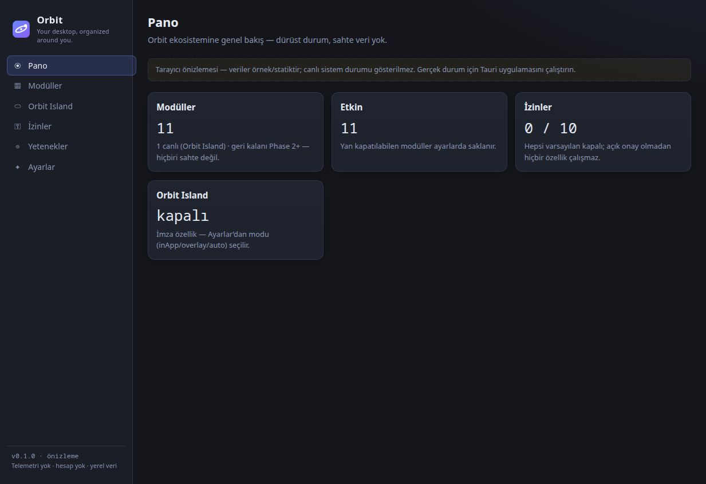

# Orbit

> Your desktop, organized around you.

Orbit is a privacy-first, open-source desktop companion for Linux (KDE/GNOME), Windows 10/11 and macOS. Twelve small projects, one coherent experience. No telemetry, no accounts, nothing forced on you.

**Honest status:** pre-alpha, Phase 1. The island engine, settings, permissions and storage work and are tested (`orbit-core`, 11 tests green). The Tauri shell is written and compiles now; it has not been packaged into a release build yet. The Svelte frontend is implemented: a shell UI with dashboard, modules, the island (live clock, ambient rows, drag-and-drop, shortcuts), permissions, capabilities and settings. Outside the Tauri host it runs in a labeled static-preview mode — clearly marked, no pretend data. Module repos stand alone and ship their own logic and tests; host-side wiring is Phase 2.



## The ecosystem (12 repositories)

This repo is the host. Every module is its own repo with its own crate, version, CI and license. You can use any of them without Orbit, and Orbit without any of them. Orbit detects what is installed, enables only what you enable, and never requires the full set.

| Repo | What it is | Status |
| --- | --- | --- |
| [Can-5/orbit](https://github.com/Can-5/orbit) | This repo. Tauri shell, settings, permission registry, the `orbit-core` engine | Shell compiles; not packaged yet |
| [Can-5/orbit-island](https://github.com/Can-5/orbit-island) | Orbit Island — the signature pill: state machine, timers, queueing, Module Protocol v1 reference (`SPEC.md`) | Domain engine, 13 tests |
| [Can-5/ghostdrop](https://github.com/Can-5/ghostdrop) | Temporary clipboard & file-drop zone | Domain engine, 7 tests |
| [Can-5/recall](https://github.com/Can-5/recall) | Local, searchable history with exclusions | Domain engine, 8 tests |
| [Can-5/renamex](https://github.com/Can-5/renamex) | Batch-rename planning (never writes without your say-so) | Domain engine, 13 tests |
| [Can-5/pixelpick](https://github.com/Can-5/pixelpick) | Color science: HEX/RGB/HSL, palettes | Domain engine, 9 tests |
| [Can-5/linknest](https://github.com/Can-5/linknest) | Local-first bookmarks, Markdown/HTML export | Domain engine, 14 tests |
| [Can-5/keyglow](https://github.com/Can-5/keyglow) | Keystroke visualization; it never sees what you type | Domain engine, 11 tests |
| [Can-5/cleanshot](https://github.com/Can-5/cleanshot) | Screenshot annotation models (no capture engine) | Domain engine, 9 tests |
| [Can-5/apppulse](https://github.com/Can-5/apppulse) | Metrics modeling: ring buffer, EMA, alert rules | Domain engine, 10 tests |
| [Can-5/snapspace](https://github.com/Can-5/snapspace) | Workspace profiles, honest restore planning | Domain engine, 9 tests |
| [Can-5/themeport](https://github.com/Can-5/themeport) | Theme engine: WCAG contrast, validated packs | Domain engine, 12 tests |

**113 module tests green** across the eleven module repos (`cargo test --locked`), plus 11 in `orbit-core`.

*Domain engine* means the platform-independent logic: validation, planning, modeling, export, state machines. The OS-facing parts (global hotkeys, clipboard hooks, screenshot capture, window management, wallpapers) belong to the Orbit host and are not faked. They are either unimplemented or reported as unavailable on your platform; Orbit never pretends otherwise.

## Orbit Island

The signature feature. A desktop take on the dynamic island. No Apple branding, no borrowed code.

- Priority-aware notification queue (≤16 items, high priority preempts)
- Toasts, clipboard/screenshot/workspace/system events
- Focus timers with pause/resume; fires once when done
- Expandable pill with size/position/auto-hide settings
- Honest per-platform support: `Supported` on Windows 10/11 and macOS; floating pill at the top-center on KDE Plasma (X11 and best-effort Wayland) and the whole X11 world; on GNOME Wayland, the in-app island
- Island overlay window: dedicated transparent window rendering only the black pill, always on top, top-center; expanded pill shows the same ambient sections
- Ambient rows (new): live clock, now-playing via MPRIS (best-effort; hidden when no player answers) with ⏮ ⏯ ⏭ controls and a volume slider, an XDG downloads watcher that catches every browser (name and size only, never content), and a drop tray that lists dropped files without touching them
- CPU/RAM readout in the island (Linux, `/proc` only; toggleable with "CPU/RAM satırı" in Settings)
- In-app shortcuts: `Ctrl+Space` toggles, `1`–`5` start 25/10/5-min and 1/2-hour timers, `Esc` collapses

The MPRIS and downloads bridges are Linux-only and compile into the shell. Orbit does not invent data: if nothing answers, the row hides instead of showing a placeholder. Volume and media controls go over MPRIS to the player; they do nothing when no player is reachable. The CPU/RAM row reads `/proc/stat` and `/proc/meminfo` locally and never leaves your machine.

## Privacy — the actual rules

- **No telemetry.** Ever. No analytics, no crash pings, no "anonymous usage statistics". There is no server and no account.
- **No network by default.** Orbit and modules talk over a local pipe.
- **Explicit grants only.** Clipboard, screen capture, keyboard listening, process metrics, file watching, network: all off until you grant them, per feature, revocable anytime. Denied means denied.
- **Your data stays yours.** SQLite on your disk. Exports are files you choose. Theme packs are local. Recall exclusions are enforced by contract.
- Details: [docs/privacy.md](docs/privacy.md)

## Build

```sh
# Core engine — works today, no GUI deps
cargo test -p orbit-core

# Desktop shell — needs system WebKitGTK dev packages on Fedora
sudo dnf install webkit2gtk4.1-devel gtk3-devel glib2-devel gcc-c++
cargo run -p orbit-tauri
```

Frontend: `pnpm install && pnpm build`, or `pnpm dev` for http://localhost:1420. Outside the Tauri host it runs as a labeled static preview; live module/permission data needs the shell. `pnpm check` is clean and the production build succeeds.

## Integration: Orbit Module Protocol v1 (draft)

Modules integrate through an opt-in, documented protocol. They never link into Orbit.

- Newline-delimited JSON over a child process's stdio; the `orbit-module.json` manifest is read before launch
- Explicit permission negotiation; you grant or deny
- Strict schemas (`deny_unknown_fields`); no code evaluation; no scripts in packs
- Spec: [docs/module-protocol-v1.md](docs/module-protocol-v1.md) and the canonical draft in `orbit-island/SPEC.md`

## Roadmap

- **Phase 1** (now): shell, design system, permissions, island prototype, `orbit-core`
- **Phase 2**: host-side wiring of GhostDrop / Recall / RenameX / PixelPick
- **Phase 3**: LinkNest / CleanShot / AppPulse / SnapSpace
- **Phase 4**: KeyGlow / ThemePort / advanced island
- **Phase 5**: release builds, packaging, CI, docs

## Contributing / Security / License

- [CONTRIBUTING.md](CONTRIBUTING.md) · [SECURITY.md](SECURITY.md) · [CODE_OF_CONDUCT.md](CODE_OF_CONDUCT.md)
- MIT © The Orbit contributors — see [LICENSE](LICENSE)
